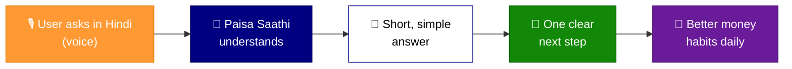

## 🪔 Product Overview

**Paisa Saathi** is a **Hindi-first, voice-first** mobile financial guidance app built for India’s **financially underserved workers** — people whose income is irregular and whose money questions often go unanswered.

# Run and deploy on Onrender : https://paisa-saathi.onrender.com/

| 🛵 Gig Workers | 📦 Delivery Agents | 🏠 Househelp | 🏗️ Construction Workers | 🚖 Drivers | 💼 Irregular Earners |
|:---:|:---:|:---:|:---:|:---:|:---:|

> [!NOTE]
> 💬 **Not a traditional financial tool — a trusted companion.**
> Paisa Saathi feels like talking to a helpful friend who explains money in short, reassuring conversations.

### 🧭 What Paisa Saathi helps with

| | Area | How it helps |
|:---:|:---|:---|
| 🤔 | **Everyday money questions** | Clear answers in plain, simple language |
| 🧾 | **Deductions** | Understand what was cut from your pay — and why |
| 🐷 | **Savings** | Build the habit of saving small amounts regularly |
| 🛡️ | **Safe investment basics** | Learn safe options and avoid risky traps |
| 👣 | **Simple next steps** | Know exactly what to do next, one step at a time |

---

## 🚀 One-Line Pitch

> [!TIP]
> ### 🎙️ *Paisa Saathi is a multilingual, voice-first financial companion that helps India’s underserved workers **understand money**, **save small amounts**, and **make safer financial decisions** — with trust, simplicity, and daily guidance.*

---

## 🤝 Core Promise

> [!IMPORTANT]
> 🗣️ **“Simple, trustworthy money guidance in the user’s own language.”**

---

## 🎯 MVP Positioning

<table>
  <tr>
    <td>👥 <b>For</b></td>
    <td>Gig workers and financially underserved individuals</td>
  </tr>
  <tr>
    <td>😟 <b>Who</b></td>
    <td>Find money decisions confusing</td>
  </tr>
  <tr>
    <td>📱 <b>Paisa Saathi is</b></td>
    <td>An AI-powered financial companion</td>
  </tr>
  <tr>
    <td>💡 <b>That provides</b></td>
    <td>Simple, trustworthy, vernacular guidance</td>
  </tr>
  <tr>
    <td>🌱 <b>So that users</b></td>
    <td>Make better financial decisions — <b>without complexity or fear</b></td>
  </tr>
</table>

---

## 🔄 How It Works

---

## 💎 Our Values

  
  
  
  
  

******************************************* To run locally *****************************

# Run and deploy your AI Studio app

This contains everything you need to run your app locally.

View your app in AI Studio: https://ai.studio/apps/3221c5b5-7454-417d-8c31-1298e07c62f9

## Run Locally

**Prerequisites:**  Node.js

1. Install dependencies:
   `npm install`
2. Set the `GEMINI_API_KEY` in [.env.local](.env.local) to your Gemini API key
3. Run the app:
   `npm run dev`
